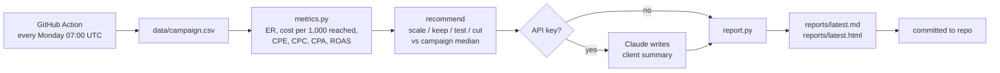

# Campaign Report Autopilot

**The Monday client report, written before anyone opens a laptop.**

Influencer campaign reporting usually means an afternoon of copying numbers into a spreadsheet and writing the same summary email. This repo does it automatically: every Monday a GitHub Action reads the campaign data, calculates the metrics clients care about, decides which creators to **scale, keep, test or cut**, and commits a fresh report to [`reports/latest.md`](reports/latest.md) (plus an [HTML version](reports/latest.html) ready to email).

With an Anthropic API key, Claude also writes the client summary paragraph, using only the computed numbers.

## What it produces

| Spend | Reach | Engagement rate | Cost per 1,000 reached | Conversions | Cost per conversion |
|---:|---:|---:|---:|---:|---:|
| EUR 19,650 | 230,900 | 5.71% | EUR 85.10 | 168 | EUR 116.96 |

> - **Scale @sofia.selfcare.** Conversions cost 33 EUR, well below the median of 54 EUR.
> - **Test @nina.naturell.** Strong engagement but no sales yet; test a discount code or clearer call to action.
> - **Cut @zurich.zoe.** Conversions cost 1,583 EUR, 29.2x the median of 54 EUR.

Full example: [`reports/latest.md`](reports/latest.md). All data in this repo is fictional.

## How it works



**Why the median, not fixed thresholds?** A "good" cost per conversion depends on the product, market and season. Comparing each creator with the rest of the same campaign gives a fair call without hand-tuning for every client.

| Action | Rule |
|---|---|
| Scale | Cost per conversion at or below 75% of the campaign median |
| Cut | Cost per conversion at least 1.5x the median, or no sales and expensive reach |
| Test | Engagement rate of 5% or more but no sales yet, so the creative works and the offer needs fixing |
| Keep | Everything in between |

## Run it

```bash
git clone https://github.com/Vishwajeetkumbhar379/campaign-report-autopilot
cd campaign-report-autopilot
pip install -e ".[dev]"
python -m autopilot data/campaign.csv --name "My campaign"
pytest
```

To switch on the AI summary in GitHub Actions, add `ANTHROPIC_API_KEY` under **Settings → Secrets and variables → Actions**. Locally, export the key and add `--ai-summary`.

## Input format

`creator, platform, cost_eur, reach, impressions, likes, comments, shares, saves, clicks, conversions, revenue_eur`, one row per creator. Most agencies can export this from their tracking sheet in a minute.

## Roadmap

- Read straight from a Google Sheet instead of CSV
- Email the HTML report to the client automatically
- Week-over-week trend lines

---

Built by [Vishwajeet Kumbhar](https://www.linkedin.com/in/vishwajeetkumbhar379) with Claude Code. MIT licence.
